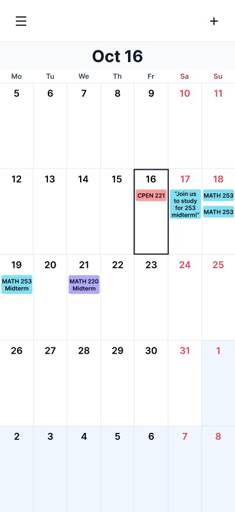
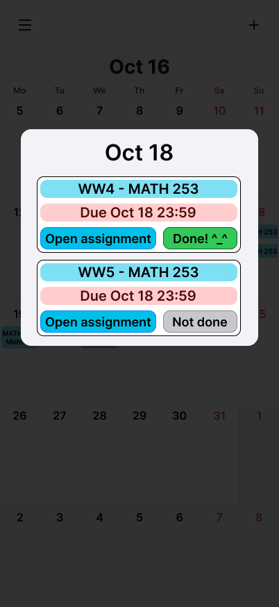
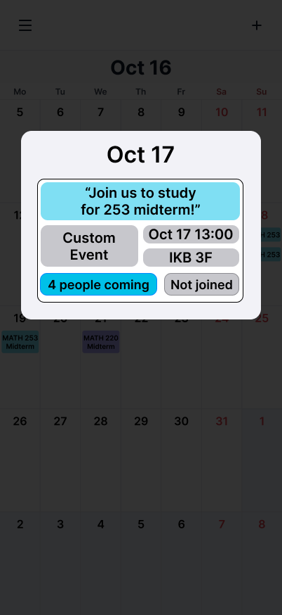
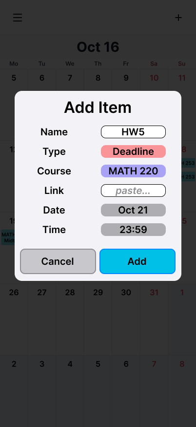
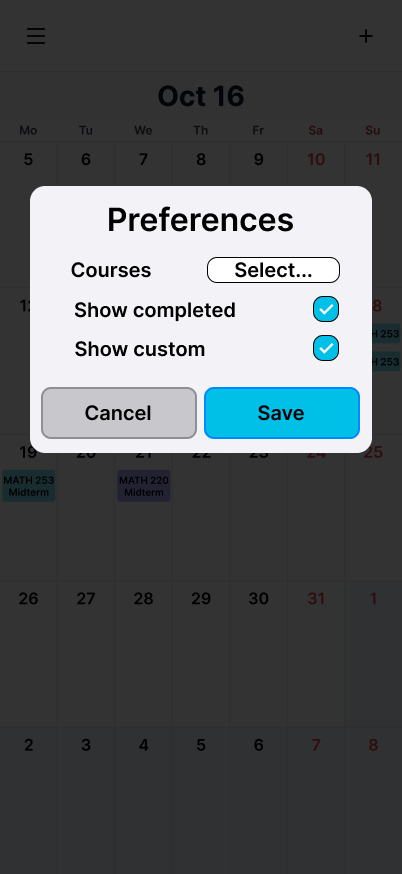
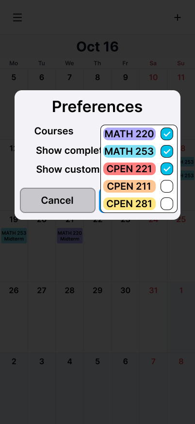

### Problem Specification
Many UBC students find it hard to keep up with deadlines because information is often spread out across multiple sources. For example, COSC 320 is run entirely through Piazza, CPEN 211 has announcements in Piazza and coursework in Canvas, and MATH 220 is split into two different Canvas courses. Students are left unsure whether they have seen every deadline, which makes them overwhelmed and anxious when tracking dates and remembering when coursework is due. Information is also constantly updated, so a student who forgets to check one platform can miss a crucial change, such as an extended deadline posted in only one place. Each instructor chooses their own tools, so no single course platform can cover every course. Once students know what is due, they still have to find people and places to work with. Finding groups to study with, planned study times, and available study spaces is difficult. Without groups formed beforehand, students have no well-known place to drop into group study sessions or other student-led events, and currently rely on word-of-mouth.
### Solution Specification
We envision a mobile-focused webapp that gives UBC courses their own community course calendars holding assignment deadlines, exams, and other important course dates. Students select the courses they’re enrolled in and see all of their dates together in a single calendar. This aggregates information that is usually spread out over several platforms into one place for students’ peace of mind, relieving stress that could come with feeling like they may be missing some crucial date on some platform they haven’t checked in a while. Our planned minimally viable product will support a fixed set of common winter semester, second-year, CPEN courses, from which students filter the ones they are taking.

The course calendar starts preloaded with initially available info that is usually on a syllabus, but uses a crowdsourcing feature to update and add new dates to the calendar, like a final exam date. Students in a course can submit updates to the calendar, which modify the course calendar instantly and show up to others in the same course. This way, our webapp will enable students to keep each other informed and up to date on course dates.

Students can also add custom events to a course calendar, such as to call for a group study session. A custom event also includes the purpose, location, and timing of the event. For example, a student could post about wanting to start a group study session for an upcoming final exam, where members review and provide feedback to each other’s work. Other students can see these events and flag events that they are interested in joining. This student-to-student environment helps students find others to study with, which is especially valuable near exam periods or assignment deadlines.

The interface is simple and intuitive. The main screen is the calendar view:

It shows all events from shared course calendars, including deadlines, exams and custom group study sessions added by students.
In the following overview, "item" refers to any such event.

The present date is displayed at the top of the page, and the present day is highlighted in the calendar.

The calendar displays 5 weeks: the present week, one past week and three coming weeks. Any day that is not part of the present month is tinted (Nov in the image above).

Clicking on one of the days in the calendar brings up the day view:

For example, this is the view brought up by clicking Oct 18. This view displays all the assignments, exams and custom events on that day. For each assignment, the deadline is shown along with an "Open assignment" button. Pressing this button sends the user to the page linked by the contributor who originally added the event to the shared calendar.

There is also a button to mark this assignment as completed, which is made to help users keep track of their assignments.

Custom event items are presented differently:

Custom events are presented with their name in quotation marks, both in the calendar view and in day view. In the day view, the details about the event are provided: the start time and location as specified by the organizer, as well as a button to flag whether you would like to join the event or not. When a student presses this button, the label (here "4 people coming") changes accordingly. If you change your mind, you can press the button again to remove the flag.

In the calendar view, the top bar has two interactive buttons: the "Add" on the right and the "Preferences" button on the left.

The user can press the "Add" button to add an item to the shared calendar:

This view presents the following fields:
- Name - the display name of the item to add
- Type: Deadline/Exam/Custom Event
- Course - which course the item is related to
- Link (hidden for any items that aren't type Deadline) - the link to the assignment page
- Date - which day to place the item on
- Time - what is the deadline / what time does the exam/custom event start

Pressing the add button on the bottom right of the panel returns the user back to the calendar view and adds the item to the shared calendar, so that all the users can see and access it. Pressing the cancel button on the bottom left simply returns the user to the calendar view, and no items are added to the calendar.

Pressing the menu button on the top left opens the preferences view:

This view allows the user to configure the following:
- Show completed - allows the user to choose whether they would like to see completed assignments on their calendar view. If this option is checked, all assignments are displayed in calendar view. If this option is unchecked, assignments marked as completed aren't shown in the calendar view, but are still displayed if the user opens the view of the corresponding day.
- Show custom - allows the user to choose whether they would like to see custom events added by other users. If this option is checked, all custom events are visible in both calendar and day views. If this option is unchecked, the calendar and day views only display the user's own custom events. Events added by any other user are hidden.
- Courses - allows the user to select which courses they are enrolled in. Pressing the "Select..." button opens a dropdown menu and allows the user to select their courses:

The calendar and day views only display courses selected in this menu.

Pressing the cancel button at the bottom of the preferences menu cancels applying any changes, and the options remain as they were before opening this view.

Pressing the save button applies the changes and updates the calendar view accordingly.
